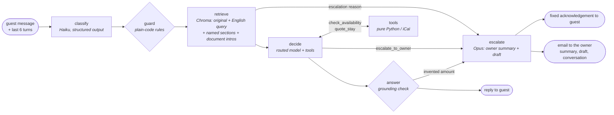
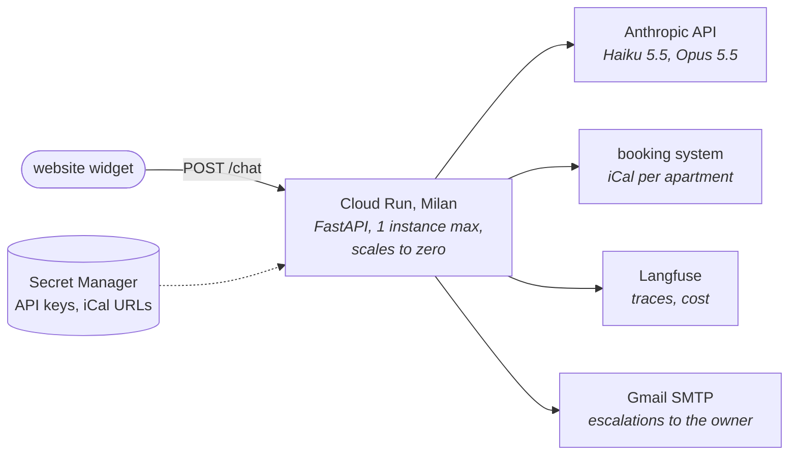

# Rocco: guest-inquiry assistant for CasaVaiano

An LLM assistant that answers guest questions for a family agriturismo in Gambassi Terme,
Tuscany. Guests write in Italian, English or German about apartments, availability, pets, the
pool, check-in, directions. Rocco (named after the farm's cat, and signed as a virtual assistant)
classifies the message, answers from a knowledge base, checks real availability, and hands the
conversation to the owner by email when it should, with a summary and a draft reply.

**Live** on the CasaVaiano website as a chat widget, served from Google Cloud Run
([docs/deploy.md](docs/deploy.md), [docs/widget-api.md](docs/widget-api.md)).

Built production-minded: LangGraph agent, RAG, tool calling, a calibrated eval suite, Langfuse
tracing, measured cost and latency, spending caps, and a real deployment with real users.

## Two modes

| | Demo / eval mode (default) | Live mode (the website) |
|---|---|---|
| Knowledge base | `data/kb`, a fictional property | `data/real/kb`: website texts and facts approved by the owner |
| Availability | `data/structured`, a fictional booking file | 8 real apartments, read from the booking system's iCal calendars (cached 15 min) |
| Prices | Computed in Python (`quote_stay`) | Never given: prices change daily (dynamic pricing). The guest gets the booking link or a quote request to the owner |
| Escalation | Summary and draft in the API response | Same, emailed to the owner over SMTP |
| Evaluated with | 82 synthetic messages, deterministic checks + calibrated judge | 30 real guest questions, compared with what the owner actually replied |

Live mode refuses to start with the fictional knowledge base, and the assistant refuses a
retriever that reads a different KB from its settings: both guards came from real bugs.

> No guest data is in this repository. The demo data is fictional. The real knowledge base holds
> only public website texts and facts the owner approved one by one. The real-question eval
> (built from the owner's sent emails, anonymised and paraphrased) stays local and git-ignored.

## Results

### Real guest questions (live mode, 30 cases)

30 replies the owner sent to guests (Jun 2025 - Nov 2026), across 15 topics. Each guest's
questions were rewritten as a new message without names or dates; Rocco answered in live mode;
an Opus judge compared Rocco's reply with the facts in the owner's real reply.

| Outcome | Cases |
|---|---|
| Consistent with the owner | 6 |
| Consistent but missing points | 8 |
| Contradicts the owner | 3 |
| Handed to the owner | 13 |

No invented facts reached a guest-facing reply. About 9 of the 13 hand-offs genuinely need a
human (existing bookings, penalties, weddings, renting the whole property); the rest were topics
missing from the KB. Of the 3 contradictions, one was a real retrieval bug (fixed, see below),
one a website-vs-owner inconsistency, one a judge misreading. Missing points became new KB facts
once the owner approved them. Cost: $0.89 per run.

### Synthetic eval set (demo mode, dev split, 62 cases)

| Metric | Routing (Haiku 5.5 + Opus 5.5) |
|---|---|
| Answer correctness (deterministic checks + calibrated LLM judge) | **88.7%** |
| Intent accuracy | 100% |
| Escalation recall / precision | **100%** / 85.7% |
| Retrieval hit rate | 97.7% |
| Tool-call accuracy (right tools, right dates) | 87.5% |
| Judge faithfulness / correctness / tone (0-3) | 2.50 / 2.85 / 2.71 |
| Latency p50 / p95 | 3.9 s / 11.3 s |
| Cost per query | **$0.0085** |

Run: `evals/results/20261117-230359_routing-baseline-v2judge.json`; every failure is listed with
the judge's reasoning in the matching `.md` report. The answer prompt has changed since (persona,
chat memory), so this baseline is re-run first in the next round of experiments, followed by
strong-model-only vs routing and the two chunking strategies end to end
([docs/TODO.md](docs/TODO.md)). The retrieval-only chunking comparison is below.

## Architecture



| Step | What it does | Why |
|---|---|---|
| classify | Intent (13 classes), secondary intents, language, confidence, risk flags, group size, and an English search query, as structured output on the cheap model, with the previous turns as context. Falls back to the strong model, then to escalation. | Cheap, fast, and the rest of the graph routes on its output. "And the week after?" becomes a booking question with the right dates. |
| guard | Deterministic rules: events, booking changes, complaints, any risk flag (refund, discount request, safety, prompt injection, abuse), groups over 6, confidence under 0.6 → escalate. | Business decisions, not language understanding. Rules in code are testable and cannot be talked around. |
| retrieve | Searches with the original message and the English rewrite, merges by best score; adds sections named in the message (apartment names) and the intro of every document retrieved from. | Each addition fixes a measured failure: idioms, proper nouns, list questions (see below). |
| decide ⇄ tools | The answer model with strict tools: `check_availability`, `quote_stay` (demo only), `escalate_to_owner`. Max 4 tool rounds. | Prices and availability are computed in code, never by the LLM. The LLM can also hand off when unsure. |
| answer | Every euro amount in the reply must appear in the retrieved context, a tool result or an earlier reply (handles `1.234,50` and `1,234.50`), otherwise escalate. | A cheap, deterministic net against invented prices. |
| escalate | The strong model writes an owner summary, priority, a draft reply in the guest's language, and what to check. The guest gets a fixed acknowledgement in their language. | The owner gets a ready-to-edit reply; the guest never gets an unchecked promise. |

### Deployment



The image bakes the embedding model and both indexes, so nothing is downloaded at startup.
Protection against runaway cost, in layers: per-IP rate limits (20 messages per 10 minutes,
150 per day), a daily cap on Claude spend (1 USD, then a polite 503 until midnight while the
contact form stays open), one instance at most, and Google's native spending cap on Cloud Run
(5 EUR per month).

## Design choices

| Choice | Why | Trade-off |
|---|---|---|
| **LangGraph** with an explicit graph | The flow is fixed and auditable: every path (answer, tools, escalation) is a visible edge, and every node is a span in the trace. | More code than a single agent loop; worth it when you must explain why a message was escalated. |
| **Anthropic SDK behind a small `LLMClient` protocol** (no LangChain model wrappers) | One method, `complete(LLMRequest) -> LLMResult`. Switching provider is one class. A `FakeLLM` makes every graph path testable without network. | You write the adapter yourself (~150 lines). |
| **Claude Haiku 5.5 + Claude Opus 5.5** | Haiku ($0.10/$0.50 per MTok) classifies and answers simple FAQs; Opus ($4/$20) handles bookings with tools, multi-intent messages and escalation drafts. | Two cache namespaces; routing rules to maintain. |
| **Structured outputs** (`output_config.format`) | Classification and drafts are validated Pydantic models. Forced `tool_choice` is not available on the 5.5 models. | — |
| **Server-side fallback** on Opus | If a strong-model request is refused, the API reruns it on a fallback model in the same call. | Beta header. |
| **Chroma** (embedded, persisted to disk) over pgvector | Under 100 chunks per KB, no database to run, ships inside the Docker image. pgvector pays off when you already run Postgres or need filtered SQL joins. | Not shared across replicas; rebuilt at image build time. |
| **fastembed + `paraphrase-multilingual-MiniLM-L12-v2`** (ONNX) | Local, free, multilingual, no PyTorch: ~1 GB smaller image than sentence-transformers. | Weak on idioms and proper nouns; mitigated by the English rewrite and by name matching. |
| **Chunking by `##` section**, prefixed with "document title - section" | Each chunk is a self-contained answer unit; the prefix tells the embedding what the chunk is about. | Lists spanning sections get lost; the document intro carries them and is always retrieved. |
| **Structured data as the source of truth** for apartments, prices and availability | `data/structured/` and `data/real/lodgings.yaml` feed the tools and the generated KB pages; tests fail if the markdown disagrees. | Two places to update; the tests make drift impossible to miss. |
| **No prices in live mode** | The property uses dynamic pricing; any number Rocco quoted would be wrong the next day. | Price questions end in a link or an email to the owner. |
| **Real KB built with the owner, not mined automatically** | 268 of the owner's sent replies were summarised (no personal data kept) to find what guests ask and what he repeats; each fact went into the KB only after he approved it (8 of 10 accepted, 3 conflicts resolved by him). | Slower than dumping emails into the index, but every fact is one the owner stands behind. |
| **Chat memory on the server** (6 turns, 24 h per session) | A client cannot invent earlier turns; the owner's email includes the whole conversation. | In-process: fine for one instance, a shared store for more. |
| **Persona: Rocco**, owner name configurable | Every reply is signed as the virtual assistant, so guests know they are talking to an AI; in live mode Rocco follows the owner's tone (friendly, short). | The persona stays in greeting and signature: a joking cat is wrong when a guest complains. |
| **Langfuse**, one trace per message | Spans per node, generations with tokens, latency and cost, retrieved chunk IDs and scores, tool inputs and outputs, eval scores attached to traces. | Cost computed from our own price table (Langfuse may not know new models). |

### Chunking, retrieval only (30 labelled queries, k=4)

| Strategy | Chunks | hit@1 | hit@4 | MRR@4 | Italian hit@1 |
|---|---|---|---|---|---|
| By `##` section | 69 | **0.87** | **0.93** | **0.89** | **0.90** |
| Fixed 150 words, 30 overlap | 31 | 0.83 | 0.90 | 0.87 | 0.60 |

## Evaluation

**Synthetic set:** 82 messages (`evals/dataset.jsonl`): Italian 26, English 34, German 21,
French 1; all 13 intents; 18 must-escalate cases (complaints, refunds, weddings, groups, prompt
injection, safety); edge cases (winter closure, fully booked August, a private event blocking
the property, inverted dates, a dog in a no-dog room, an infant who does not count toward
capacity, stays across two seasons, the 7-night discount); ambiguous and multi-intent messages;
typos. 62 dev cases for iteration, **20 test cases held out** until the end.

Each case declares expected intent(s), acceptable behaviours (answer / clarify / escalate),
expected tools and arguments, key facts the reply must contain, and the knowledge-base sections
retrieval should hit. All 11 expected prices were computed by hand and cross-checked against the
tools before the first run.

| Metric | How |
|---|---|
| Answer correctness | Right behaviour **and** all deterministic checks **and** judge faithfulness ≥ 2, correctness ≥ 2, tone ≥ 2 |
| Intent accuracy | Predicted intent in the accepted set |
| Escalation precision / recall | Positive class = escalated; ambiguous cases accept both |
| Retrieval hit rate | An expected KB section is among the retrieved chunks |
| Tool accuracy | Required tools called, with the expected dates and options |
| Key facts | Amounts matched numerically (`€1.449` = `€1,449` = `1449 EUR`), text case-insensitive |
| LLM judge | Opus 5.5 with a 0-3 rubric for faithfulness, correctness, language & tone; separate rubric for escalation drafts. Calibrated on 28 hand-labelled replies (96% agreement) |
| Latency, cost | p50/p95 per message; cost per query from token usage |

**Real questions:** `scripts/real_eval.py` builds the cases from the owner's mailbox (read-only,
paraphrased, no names or dates) and compares Rocco with the owner. Output stays in the
git-ignored `evals/real/`.

```bash
uv run python scripts/run_evals.py --label routing                 # dev split, ~$1.50
uv run python scripts/run_evals.py --label strong-only --no-routing
uv run python scripts/compare_runs.py --latest 2                   # side by side + flipped cases
uv run python scripts/rejudge.py evals/results/<run>.json --label v2   # judge only, no agent calls
```

## What did not work (and what it taught me)

Full log with numbers in [docs/experiments.md](docs/experiments.md).

1. **The first LLM judge was wrong, not the agent.** First run: 71% correctness. The judge
   flagged "Giulia confirms after the 30% deposit" as invented, because that fact lives in the
   assistant's system prompt, which the judge did not see. I labelled 28 replies by hand:
   agreement was **64%**. After giving the judge the operator instructions as a source,
   agreement rose to **96%** and correctness to 90.3%, with no change to the agent. Without the
   labels I would have "fixed" the prompt against a broken metric.
2. **The first real-question eval ran on the fictional KB.** Rocco answered real guests with the
   demo property's breakfast and pool hours. The script switched to live mode on a copy of the
   settings, but the retriever re-read the global ones. Now the assistant refuses a retriever
   whose KB differs from its settings, with a regression test. A green eval is worth nothing
   until you have checked what it actually ran on.
3. **"The Ginestra apartment does not exist."** Embeddings are weak on proper nouns: the query
   retrieved another apartment whose description mentions "ginestre in fiore" (flowering broom).
   Fix: sections whose title is named in the message are always retrieved.
4. **The first bug from a real user: 3 of 5 ground-floor apartments.** Each apartment is its own
   chunk, so a "which ones are on the ground floor" answer depended on which cards retrieval
   happened to return. Adding the list to the intro was not enough (the intro ranked below the
   cards). Now the intro of every document retrieved from is always included.
5. **Costs were counted twice in Langfuse.** The Anthropic SDK emits its own OpenTelemetry
   generation span, and Langfuse ingests it next to mine. Found by checking a trace through the
   Langfuse API, not by trusting the dashboard. Fixed with `open_telemetry=False` and a test.
6. **Disabled thinking leaked reasoning into a reply.** Haiku with thinking off wrote its English
   reasoning before the Italian answer. The judge scored tone 1, but my pass rule ignored tone,
   so it counted as correct. Now a reply you cannot send is a failure.
7. **The grounding check is a coarse net.** Haiku computed a tourist tax itself (€15); the check
   passed it only because €15 also appears in the KB as another fee. And it cannot see invented
   non-numeric facts: that is the judge's job.
8. **Small embedding models miss idioms.** "Quanto costa la tassa di soggiorno?" did not retrieve
   the "Tourist tax" section; the English phrasing did. Retrieval now uses both the original
   message and an English rewrite from the classifier.

## Cost at 100k queries per month

Measured cost per message type (demo dev run, routing on):

| Type | Share of dev set | Cost per message | p50 latency |
|---|---|---|---|
| FAQ answered by Haiku | 56% | $0.00027 | 2.6 s |
| Booking with tools (Opus) | 11% | $0.0374 | 11.3 s |
| Other answers on Opus | 10% | $0.0128 | 6.5 s |
| Escalation (Opus draft) | 23% | $0.0127 | 6.7 s |

With an assumed production mix of 55% FAQ, 20% bookings, 10% other, 15% escalations, the average
is about **$0.011 per message, ~$1,100 per month** for 100k messages. Bookings are ~70% of it.
These are estimates from the eval set, not production traffic.

100k messages a month is about 0.04 per second on average, a handful at a time at peak: the
load is small. Infrastructure would cost tens of euros; **tokens are where the money is**. What
I would change:

- **Routing:** measure Haiku on simple bookings (one apartment, clear dates). If quality holds,
  booking cost drops by an order of magnitude; that is the biggest lever.
- **Caching:** prompt caching is already on (tools + system prompt). Add an exact-match answer
  cache for date-free FAQs keyed on (intent, language, normalised question), invalidated when
  the KB fingerprint changes.
- **Batching:** escalation drafts are read by the owner later, not by the guest now. Generate them
  through the Message Batches API at 50% of the price; the guest still gets the instant
  acknowledgement.
- **Several instances, for reliability, not for load:** chat memory, rate limits and the daily
  cap move from process memory to Redis or Firestore; the iCal calendars are refreshed by a
  scheduled job instead of on request; escalation email goes through a transactional provider
  (Gmail allows about 500 a day).
- **Fallbacks:** already in place for classifier failure (cheap → strong → escalate) and model
  refusals (server-side fallback). Add a provider-level circuit breaker and an "LLM
  down" mode that escalates everything with the fixed acknowledgement.
- **Monitoring:** Langfuse dashboards and alerts on cost per message, escalation rate by reason,
  grounding-check failures, p95 latency, and the share of traffic on the strong model. Sample
  production traces weekly into the eval set. At this volume traces exceed the Langfuse free
  tier: sample them or move to a paid or self-hosted plan.
- **Streaming and async:** stream replies to the widget and move to the async client, so slow
  booking turns do not hold workers that FAQ answers need.

For CasaVaiano today, none of this is worth it: one instance that scales to zero costs nothing
when nobody is chatting.

## When not to use the LLM

Most of this system deliberately is not LLM:

- **Prices, discounts, deposits, tourist tax, availability:** Python over structured data and the
  booking system's calendars. An LLM doing arithmetic on money is a liability.
- **Booking rules** (Saturday-to-Saturday in July and August, 3-night minimum, 5 guests per
  apartment with the extra bed): code, not prompt.
- **Escalation policy:** plain-code rules on the classifier's output. Whether a complaint goes to
  the owner is a business decision, and rules cannot be argued with.
- **The acknowledgement after an escalation:** a fixed template per language. No model, no risk.
- **Grounding check and eval checks:** deterministic first; the LLM judge only grades what string
  matching cannot.
- **Retrieval:** a local embedding model, no API call.
- **Abuse and cost limits:** rate limits and spending caps in code and in Google Cloud, not a
  prompt asking the model to be brief.

And some requests should not get an automatic answer at all: complaints, refunds, booking
changes, weddings and anything that commits the business to money or an exception goes to a
human, with a draft to save them time.

## Running it

```bash
uv sync
cp .env.example .env          # add ANTHROPIC_API_KEY (Langfuse keys optional)
uv run python scripts/build_index.py        # downloads the embedding model (~220 MB) once
uv run uvicorn casavaiano.api.main:app --port 8000
# open http://localhost:8000
```

Ask from the command line, or run with Docker:

```bash
uv run python scripts/ask.py --today 2026-11-17 "Accettate cani?"
docker build -t casavaiano-assistant .
docker run --rm -p 8080:8080 --env-file .env casavaiano-assistant
```

Live mode needs the iCal URLs (`CASA_ICAL_<APARTMENT>`) and, for escalation emails, SMTP
settings in `.env` (see `.env.example`):

```bash
uv run python scripts/import_site_kb.py --site ../CasavaianoWebsite   # after editing the site
AVAILABILITY_SOURCE=slope KB_DIR=data/real/kb RETRIEVAL_K=6 uv run uvicorn casavaiano.api.main:app --port 8000
```

Deploying an update to Cloud Run: [docs/deploy.md](docs/deploy.md).

Tests and lint (no API keys needed; `-m live` runs the two real-API smoke tests):

```bash
uv run pytest
uv run ruff check . && uv run ruff format --check .
```

## Project layout

```
data/kb/                  demo knowledge base (markdown, fictional)
data/structured/          demo rooms, seasons and fees, bookings: source of truth for the tools
data/real/                real apartments (lodgings.yaml), real knowledge base, open questions
src/casavaiano/
  agent/                  graph, nodes, guards, routing, prompts, grounding check, chat memory
  llm/                    LLMClient protocol, Anthropic client, fake client, prices
  rag/                    chunking, embeddings, Chroma retriever, retrieval metrics
  tools/                  demo availability and quote tools, iCal availability, tool schemas
  evals/                  dataset model, checks, judge, metrics, runner, reports
  api/                    FastAPI app, rate limits and daily cap, demo chat page
  notify.py               escalation and contact emails (SMTP)
  observability.py        Langfuse wrapper (no-op without keys)
evals/                    dataset, judge calibration labels, results of every run
scripts/                  build_index, ask, run_evals, compare_runs, rejudge, compare_chunking,
                          import_site_kb, real_eval
docs/                     experiment log, TODO, deploy, widget API
```

## Limitations

- One instance by design: chat memory, rate limits and the daily cap live in process memory.
- The first message after idle waits about 20 s (cold start, embedding model loading);
  `min-instances=1` removes it for 10-15 EUR a month.
- Minimum-stay rules set in the pricing tool do not appear in the iCal feed; Rocco applies the
  general rules, and the booking engine has the final word.
- The synthetic eval set was written by the same person who built the system; the held-out test
  split, the hand-labelled judge calibration and the real-question eval are the guards against
  overfitting to it.
- The judge is the same model family as the strong model; deterministic checks limit, but do not
  remove, that bias.
