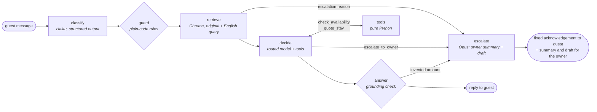

# CasaVaiano guest-inquiry assistant

An LLM assistant that answers guest emails and chat messages for a family agriturismo in
Gambassi Terme, Tuscany. Guests write in Italian, English or German about rooms, prices,
availability, dogs, the restaurant, weddings, directions. The assistant classifies the message,
answers from a knowledge base, checks availability and prices with real tools, and hands the
conversation to the owner when it should, with a summary and a draft reply.

Built as a production-minded portfolio project: LangGraph agent, RAG, tool calling, a calibrated
eval suite, Langfuse tracing, and measured latency and cost.

> All data in `data/` is fictional. No real guest data is used anywhere.

## Results (dev split, 62 cases)

| Metric | Routing (Haiku 5.5 + Opus 5.5) |
|---|---|
| Answer correctness (deterministic checks + calibrated LLM judge) | **88.7%** |
| Intent accuracy | 100% |
| Escalation recall / precision | **100%** / 85.7% |
| Retrieval hit rate | 97.7% |
| Tool-call accuracy (right tools, right dates) | 87.5% |
| Judge faithfulness / correctness / tone (0-3) | 2.50 / 2.85 / 2.71 |
| Latency p50 / p95 | 3.9 s / 11.3 s |
| Cost per query | **$0.0085** |

Run: `evals/results/20261117-230359_routing-baseline-v2judge.json`. Every failure is listed with
the judge's reasoning in the matching `.md` report.

Comparisons still to run (see [docs/TODO.md](docs/TODO.md)): strong model only vs routing, and
the two chunking strategies end to end. The retrieval-only chunking comparison is below.

## Architecture



| Step | What it does | Why |
|---|---|---|
| classify | Intent (13 classes), secondary intents, language, confidence, risk flags, group size, and an English search query, as structured output on the cheap model. Falls back to the strong model, then to escalation. | Cheap, fast, and the rest of the graph routes on its output. |
| guard | Deterministic rules: events, booking changes, complaints, any risk flag (refund, discount request, safety, prompt injection, abuse), groups over 6, confidence under 0.6 → escalate. | Business decisions, not language understanding. Rules in code are testable and cannot be talked around by a cleverly written message. |
| retrieve | Searches with the original message and the English rewrite, merges by best score. | The multilingual model misses idioms ("tassa di soggiorno"); the rewrite targets them (end-to-end effect to be measured, see TODO). |
| decide ⇄ tools | The answer model with three strict tools: `check_availability`, `quote_stay`, `escalate_to_owner`. Max 4 tool rounds. | Prices and availability are computed in Python from structured data, never by the LLM. The LLM can also hand off when unsure. |
| answer | Every euro amount in the reply must appear in the retrieved context or a tool result (handles `1.234,50` and `1,234.50`), otherwise escalate. | A cheap, deterministic net against invented prices. |
| escalate | The strong model writes an owner summary, priority, a draft reply in the guest's language, and what to check. The guest gets a fixed acknowledgement in their language. | The owner gets a ready-to-edit reply; the guest never gets an unchecked promise. |

## Design choices

| Choice | Why | Trade-off |
|---|---|---|
| **LangGraph** with an explicit graph | The flow is fixed and auditable: every path (answer, tools, escalation) is a visible edge, and every node is a span in the trace. | More code than a single agent loop; worth it when you must explain why a message was escalated. |
| **Anthropic SDK behind a small `LLMClient` protocol** (no LangChain model wrappers) | One method, `complete(LLMRequest) -> LLMResult`. Switching provider is one class. A `FakeLLM` makes every graph path testable without network. | You write the adapter yourself (~150 lines). |
| **Claude Haiku 5.5 + Claude Opus 5.5** | Haiku ($0.10/$0.50 per MTok) classifies and answers simple FAQs; Opus ($4/$20) handles bookings with tools, multi-intent messages and escalation drafts. | Two cache namespaces; routing rules to maintain. |
| **Structured outputs** (`output_config.format`) | Classification and drafts are validated Pydantic models. Forced `tool_choice` is not available on the 5.5 models. | — |
| **Server-side refusal fallback** on Opus | If a strong-model request is refused, the API reruns it on a fallback model in the same call. | Beta header. |
| **Chroma** (embedded, persisted to disk) over pgvector | 69 chunks, no database to run, ships inside the Docker image. pgvector pays off when you already run Postgres or need filtered SQL joins. | Not shared across replicas; rebuilt at image build time. |
| **fastembed + `paraphrase-multilingual-MiniLM-L12-v2`** (ONNX) | Local, free, multilingual (IT/DE questions against an English KB), no PyTorch: ~1 GB smaller image than sentence-transformers. | Weaker on idioms than large models; mitigated by the English query rewrite. |
| **Chunking by `##` section**, prefixed with "document title - section" | Each chunk is a self-contained answer unit; the prefix tells the embedding what the chunk is about. | Relies on a well-structured KB (enforced by tests). |
| **Structured data as the source of truth** for prices and availability | `data/structured/` feeds the tools; a test fails if the markdown KB disagrees with it. | Two places to update; the test makes drift impossible to miss. |
| **Persona: Rocco**, named after the farm's cat; owner name configurable (`ASSISTANT_NAME`, `OWNER_NAME`) | Every reply is signed as the virtual assistant, so guests know they are talking to an AI; the acknowledgement after an escalation names who will reply. | The persona stays in greeting and signature: a joking cat is wrong when a guest complains. |
| **Langfuse**, one trace per message | Spans per node, generations with tokens, latency and cost, retrieved chunk IDs and scores, tool inputs and outputs, eval scores attached to traces. | Cost computed from our own price table (Langfuse may not know new models). |

### Chunking, retrieval only (30 labelled queries, k=4)

| Strategy | Chunks | hit@1 | hit@4 | MRR@4 | Italian hit@1 |
|---|---|---|---|---|---|
| By `##` section | 69 | **0.87** | **0.93** | **0.89** | **0.90** |
| Fixed 150 words, 30 overlap | 31 | 0.83 | 0.90 | 0.87 | 0.60 |

## Evaluation

82 synthetic messages (`evals/dataset.jsonl`): Italian 26, English 34, German 21, French 1; all
13 intents; 18 must-escalate cases (complaints, refunds, weddings, groups, prompt injection,
safety); edge cases (winter closure, fully booked August, a private event blocking the
property, inverted dates, a dog in a no-dog room, an infant who does not count toward capacity,
stays across two seasons, the 7-night discount); ambiguous and multi-intent messages; typos.
62 dev cases for iteration, **20 test cases held out** until the end.

Each case declares expected intent(s), acceptable behaviours (answer / clarify / escalate),
expected tools and arguments, key facts the reply must contain, and the knowledge-base sections
retrieval should hit. All 11 expected prices were computed by hand and cross-checked against the
tools before the first run.

| Metric | How |
|---|---|
| Answer correctness | Right behaviour **and** all deterministic checks **and** judge faithfulness ≥ 2, correctness ≥ 2, tone ≥ 2 |
| Intent accuracy | Predicted intent in the accepted set |
| Escalation precision / recall | Positive class = escalated; ambiguous cases accept both |
| Retrieval hit rate | An expected KB section is among the retrieved chunks |
| Tool accuracy | Required tools called, with the expected dates and options |
| Key facts | Amounts matched numerically (`€1.449` = `€1,449` = `1449 EUR`), text case-insensitive |
| LLM judge | Opus 5.5 with a 0-3 rubric for faithfulness, correctness, language & tone; separate rubric for escalation drafts |
| Latency, cost | p50/p95 per message; cost per query from token usage |

```bash
uv run python scripts/run_evals.py --label routing                 # dev split
uv run python scripts/run_evals.py --label strong-only --no-routing
uv run python scripts/compare_runs.py --latest 2                   # side by side + flipped cases
uv run python scripts/rejudge.py evals/results/<run>.json --label v2   # judge only, no agent calls
```

One dev run costs about $1.50 (agent $0.53, judge ~$0.95).

## What did not work (and what it taught me)

Full log with numbers in [docs/experiments.md](docs/experiments.md).

1. **The first LLM judge was wrong, not the agent.** First run: 71% correctness. The judge
   flagged "Giulia confirms after the 30% deposit" as invented, because that fact lives in the
   assistant's system prompt, which the judge did not see; it also passed the same sentence in
   other cases. I labelled 28 replies by hand: agreement was **64%**. After giving the judge the
   operator instructions as a source, agreement rose to **96%** and correctness to 90.3%, with
   no change to the agent. Without the labels I would have "fixed" the prompt against a broken
   metric.
2. **Costs were counted twice in Langfuse.** The Anthropic SDK emits its own OpenTelemetry
   generation span, and Langfuse ingests it next to mine. Every trace showed 2x the real spend.
   Found by checking a trace through the Langfuse API, not by trusting the dashboard. Fixed with
   `open_telemetry=False` and a regression test.
3. **Disabled thinking leaked reasoning into a reply.** Haiku with thinking off wrote its English
   reasoning before the Italian answer ("Rispondo in italiano: ..."). The judge scored tone 1,
   but my pass rule ignored tone, so it counted as correct. Now a reply you cannot send is a
   failure.
4. **The grounding check is a coarse net.** Haiku computed a tourist tax itself (€15); the check
   passed it only because €15 also appears in the KB as the dog fee. And it cannot see invented
   non-numeric facts ("the taxi takes 20 minutes"): that is the judge's job.
5. **Small embedding models miss idioms.** "Quanto costa la tassa di soggiorno?" did not retrieve
   the "Tourist tax" section; the English phrasing scored 0.68 on it. The agent now retrieves
   with both the original message and an English rewrite produced by the classifier; the
   original-vs-rewritten comparison is in the M6 TODO.

## Cost at 100k queries per month

Measured cost per message type (dev run, routing on):

| Type | Share of dev set | Cost per message | p50 latency |
|---|---|---|---|
| FAQ answered by Haiku | 56% | $0.00027 | 2.6 s |
| Booking with tools (Opus) | 11% | $0.0374 | 11.3 s |
| Other answers on Opus | 10% | $0.0128 | 6.5 s |
| Escalation (Opus draft) | 23% | $0.0127 | 6.7 s |

With an assumed production mix of 55% FAQ, 20% bookings, 10% other, 15% escalations, the average
is about **$0.011 per message, ~$1,100 per month** for 100k messages. Bookings are ~70% of it.
These are estimates from the eval set, not production traffic.

What I would change to serve that volume:

- **Routing:** measure Haiku on simple bookings (one unit, clear dates). If quality holds, booking
  cost drops by an order of magnitude; that is the biggest lever.
- **Caching:** prompt caching is already on (tools + system prompt). Add an exact-match answer
  cache for date-free FAQs keyed on (intent, language, normalised question), invalidated when
  the KB fingerprint changes.
- **Batching:** escalation drafts are read by the owner later, not by the guest now. Generate them
  through the Message Batches API at 50% of the price; the guest still gets the instant
  acknowledgement.
- **Fallbacks:** already in place for classifier failure (cheap → strong → escalate) and model
  refusals (server-side fallback). Add a provider-level circuit breaker and an "LLM down" mode
  that escalates everything with the fixed acknowledgement.
- **Monitoring:** Langfuse dashboards and alerts on cost per message, escalation rate by reason,
  grounding-check failures, p95 latency, and the share of traffic on the strong model. Sample
  production traces weekly into the eval set. At this volume traces exceed the Langfuse free
  tier: sample them or move to a paid or self-hosted plan.
- **Async API:** move to the async client so slow booking turns do not hold worker threads that
  FAQ answers need.

## When not to use the LLM

Most of this system deliberately is not LLM:

- **Prices, discounts, deposits, tourist tax, availability:** Python over structured data. An LLM
  doing arithmetic on money is a liability.
- **Escalation policy:** plain-code rules on the classifier's output. Whether a complaint goes to
  the owner is a business decision, and rules cannot be argued with.
- **The acknowledgement after an escalation:** a fixed template per language. No model, no risk.
- **Grounding check and eval checks:** deterministic first; the LLM judge only grades what string
  matching cannot.
- **Retrieval:** a local embedding model, no API call.

And some requests should not get an automatic answer at all: complaints, refunds, booking
changes, weddings and anything that commits the business to money or an exception goes to a
human, with a draft to save them time.

## Running it

```bash
uv sync
cp .env.example .env          # add ANTHROPIC_API_KEY (Langfuse keys optional)
uv run python scripts/build_index.py        # downloads the embedding model (~220 MB) once
uv run uvicorn casavaiano.api.main:app --port 8000
# open http://localhost:8000
```

Ask from the command line, or run with Docker:

```bash
uv run python scripts/ask.py --today 2026-11-17 "Accettate cani?"
docker build -t casavaiano-assistant .
docker run --rm -p 8080:8080 --env-file .env casavaiano-assistant
```

Real-site mode (the 8 real apartments, availability from the Slope iCal calendars, no prices,
knowledge base generated from the website):

```bash
uv run python scripts/import_site_kb.py --site ../CasavaianoWebsite   # after editing the site
AVAILABILITY_SOURCE=slope KB_DIR=data/real/kb RETRIEVAL_K=6 uv run uvicorn casavaiano.api.main:app --port 8000
```

The demo/eval mode (default) keeps using the fictional data in `data/kb` and `data/structured`;
slope mode refuses to start with that fictional knowledge base.

Tests and lint (no API keys needed; `-m live` runs the two real-API smoke tests):

```bash
uv run pytest
uv run ruff check . && uv run ruff format --check .
```

## Project layout

```
data/kb/                  knowledge base (markdown, fictional)
data/structured/          rooms, seasons and fees, bookings: source of truth for the tools
src/casavaiano/
  agent/                  graph, nodes, guards, routing, prompts, grounding check
  llm/                    LLMClient protocol, Anthropic client, fake client, prices
  rag/                    chunking, embeddings, Chroma retriever, retrieval metrics
  tools/                  availability and quote tools, tool schemas
  evals/                  dataset model, checks, judge, metrics, runner, reports
  api/                    FastAPI app and the demo chat page
  observability.py        Langfuse wrapper (no-op without keys)
evals/                    dataset, judge calibration labels, results of every run
scripts/                  build_index, ask, run_evals, compare_runs, rejudge, compare_chunking
docs/                     experiment log, TODO
```

## Limitations

- Single-turn: each message is answered on its own; chat history is not used yet.
- The eval set is synthetic and written by the same person who built the system; the 20-case
  test split and the hand-labelled judge calibration are the guards against overfitting to it.
- The judge is the same model family as the strong model; deterministic checks limit, but do not
  remove, that bias.
- Availability is read from a JSON file; a real deployment would call the booking system.
